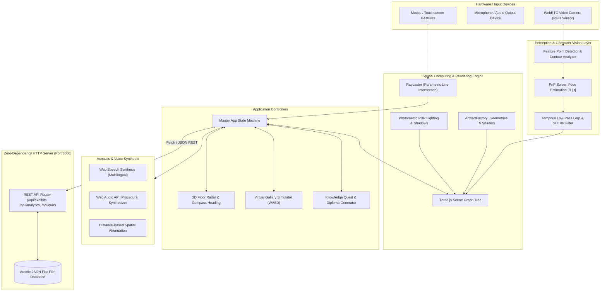

# ChronosAR: Technical Architecture Specification

**Academic Research & System Design Dossier for Final Year B.Tech / B.E. Computer Science & Engineering (AR/VR Specialization)**

---

## 1. System Overview & Milgram's Reality Continuum

In spatial computing, Augmented Reality occupies a distinct position along **Milgram's Reality-Virtuality Continuum (1994)**:

$$\text{Real Environment} \longleftrightarrow \underbrace{\textbf{Augmented Reality (AR)} \longleftrightarrow \text{Augmented Virtuality (AV)}}_{\textbf{Mixed Reality (MR)}} \longleftrightarrow \text{Virtual Reality (VR)}$$

**ChronosAR** bridges both ends of this spectrum:
- **Augmented Reality Mode**: Overlays synthetic 3D holograms, spatial UI annotations, and multispectral radiographic inspection planes onto physical artifacts using video see-through WebRTC computer vision.
- **Virtual Reality / Simulation Mode**: Synthesizes a 3D neoclassical museum environment enabling desktop and remote inspection without requiring physical cameras or printed target markers.

---

## 2. End-to-End System Architecture

---

## 3. Mathematical Foundations & Formulations

### 3.1 The 3D Pinhole Camera Model & Projection Pipeline

The mapping from a 3D point $\mathbf{P}_w = [X_w, Y_w, Z_w, 1]^T$ in object world coordinates to 2D pixel coordinates $\mathbf{p} = [u, v, 1]^T$ is governed by the fundamental projective camera equation:

$$s \begin{bmatrix} u \\ v \\ 1 \end{bmatrix} = \mathbf{K} \cdot [\mathbf{R} \mid \mathbf{t}] \cdot \begin{bmatrix} X_w \\ Y_w \\ Z_w \\ 1 \end{bmatrix}$$

Where:
- $s \in \mathbb{R}$ is the projective scale factor.
- $\mathbf{K}$ is the $3 \times 3$ **Camera Intrinsic Calibration Matrix**:
  $$\mathbf{K} = \begin{bmatrix} f_x & 0 & c_x \\ 0 & f_y & c_y \\ 0 & 0 & 1 \end{bmatrix}$$
  $(f_x, f_y)$ are focal lengths in pixel dimensions, and $(c_x, c_y)$ is the principal optical center.
- $[\mathbf{R} \mid \mathbf{t}]$ is the $3 \times 4$ **Extrinsic Calibration Matrix** representing the 6-DoF rigid body pose:
  - $\mathbf{R} \in SO(3)$ is the orthogonal $3 \times 3$ rotation matrix ($\mathbf{R}^T \mathbf{R} = \mathbf{I}$, $\det(\mathbf{R}) = 1$).
  - $\mathbf{t} = [t_x, t_y, t_z]^T$ is the translation vector expressing the origin of the world frame in camera coordinates.

---

### 3.2 Perspective-n-Point (PnP) Pose Estimation

Given $n \ge 4$ non-collinear coplanar 3D points $\mathbf{P}_i$ on the marker and their corresponding 2D image projections $\mathbf{p}_i$, ChronosAR solves for the homography $\mathbf{H} \in \mathbb{R}^{3 \times 3}$:

$$\mathbf{p}_i \sim \mathbf{H} \mathbf{P}_i \quad \text{where} \quad \mathbf{H} = \mathbf{K} [\mathbf{r}_1 \mid \mathbf{r}_2 \mid \mathbf{t}]$$

Using Singular Value Decomposition (SVD):
$$\mathbf{r}_1 = \lambda \mathbf{K}^{-1} \mathbf{h}_1, \quad \mathbf{r}_2 = \lambda \mathbf{K}^{-1} \mathbf{h}_2, \quad \mathbf{r}_3 = \mathbf{r}_1 \times \mathbf{r}_2, \quad \mathbf{t} = \lambda \mathbf{K}^{-1} \mathbf{h}_3$$
where $\lambda = \frac{1}{\|\mathbf{K}^{-1} \mathbf{h}_1\|}$.

---

### 3.3 Temporal Low-Pass Filtering (SLERP & Lerp)

To eliminate camera sensor noise and optical jitter:
1. **Translation Lerp**:
   $$\mathbf{t}_{filtered}(k) = (1 - \alpha) \mathbf{t}_{filtered}(k-1) + \alpha \mathbf{t}_{target}(k)$$
2. **Rotation Spherical Linear Interpolation (SLERP)**:
   $$\mathbf{q}_{filtered} = \text{slerp}(\mathbf{q}_{filtered}(k-1), \mathbf{q}_{target}(k), \alpha) = \frac{\sin((1 - \alpha)\theta)}{\sin\theta} \mathbf{q}_{k-1} + \frac{\sin(\alpha\theta)}{\sin\theta} \mathbf{q}_{target}$$
   where $\cos\theta = \mathbf{q}_{k-1} \cdot \mathbf{q}_{target}$ and $\alpha = 0.22$.

---

### 3.4 3D Raycasting Intersection

Ray equation from camera center $\mathbf{O}$ in direction $\mathbf{D}$:
$$\mathbf{r}(t) = \mathbf{O} + t \mathbf{D}, \quad t \ge 0$$

Intersection with a spatial spherical hotspot bounding volume of radius $r$ centered at $\mathbf{C}$:
$$\|\mathbf{O} + t \mathbf{D} - \mathbf{C}\|^2 = r^2$$
Expanding into quadratic form $a t^2 + b t + c = 0$:
$$a = \|\mathbf{D}\|^2 = 1, \quad b = 2 \mathbf{D} \cdot (\mathbf{O} - \mathbf{C}), \quad c = \|\mathbf{O} - \mathbf{C}\|^2 - r^2$$
$$\Delta = b^2 - 4ac \ge 0 \implies t = \frac{-b - \sqrt{\Delta}}{2}$$

---

### 3.5 Distance-Based Spatial Audio Attenuation

Acoustic pressure attenuation follows the linear clamp distance model:
$$A(d) = \begin{cases} 
1.0 & \text{if } d \le d_{min} \\
1.0 - \frac{d - d_{min}}{d_{max} - d_{min}} & \text{if } d_{min} < d < d_{max} \\
0.05 & \text{if } d \ge d_{max}
\end{cases}$$
with $d_{min} = 1.0\text{m}$ and $d_{max} = 12.0\text{m}$.

---

## 4. REST API Endpoint Specifications

| Method | Endpoint | Description | Status Code |
| :--- | :--- | :--- | :--- |
| `GET` | `/api/exhibits` | Retrieves complete catalog of 6 archaeological exhibits. | `200 OK` |
| `GET` | `/api/exhibits/:id` | Retrieves single exhibit by ID. | `200 OK` / `404 Not Found` |
| `POST` | `/api/exhibits` | Curator updates description or audio script. | `200 OK` |
| `GET` | `/api/analytics` | Retrieves visitor count, scans, dwell time, quiz pass rates. | `200 OK` |
| `POST` | `/api/analytics/event`| Logs marker scan, session start, or hotspot interaction. | `200 OK` |
| `POST` | `/api/quiz/submit` | Logs quiz completion, score, and certificate credential. | `200 OK` |
