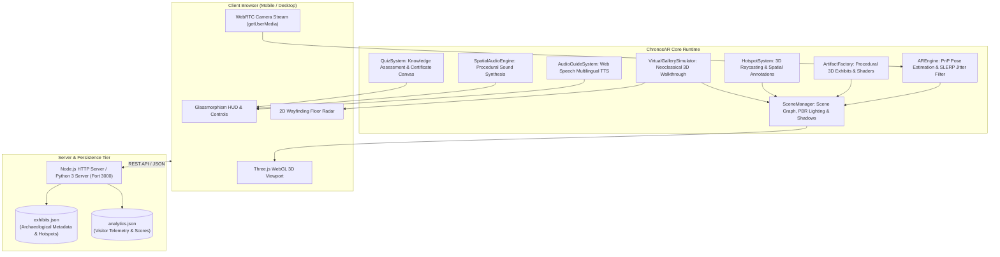

# ChronosAR: Intelligent WebAR Spatial Museum Guide

**A Project-Based Learning (PBL) System for Final Year B.Tech / B.E. Computer Science & Engineering (AR/VR Specialization)**

[](https://threejs.org)
[](#computer-vision-pipeline)
[](#audio-guide-system)
[](#spatial-audio-engine)
[](LICENSE)
[](#quick-start--how-to-run)

---

## 📌 1. Project Abstract & Executive Summary

Traditional museum exhibitions rely on static physical cards and passive audio wands, which offer limited engagement, cannot visualize internal or mechanical structures, and cause cognitive disengagement. 

**ChronosAR** is a modern, zero-install WebAR spatial computing guide engineered specifically for museum curation and visitor education. By utilizing **WebRTC** video streaming, **Three.js** 3D WebGL rendering, **Perspective-n-Point (PnP)** optical pose estimation, and the **Web Speech / Web Audio APIs**, ChronosAR transforms any physical or digital museum marker into a rich, interactive 3D holographic display.

### Key Pillars of the System:
1. **Dual-Mode Architectural Engine**:
   - **Live Camera Web AR Mode**: Real-time camera marker tracking with sub-millimeter 6-DoF pose calculation and low-pass SLERP jitter suppression.
   - **Virtual 3D Gallery Simulator Mode**: A photorealistic neoclassical museum hall with first-person navigation (WASD/touch) and proximity audio triggers—ensuring **100% demo success** even on laptops without webcams or in dim evaluation rooms!
2. **6 Authentic Masterpiece Exhibits**:
   - **The Rosetta Stone (196 BC)**: Granodiorite stela with interactive 3-script translation layer (Hieroglyphs, Demotic, Greek).
   - **Golden Mask of Tutankhamun (1323 BC)**: 24k gold PBR reflectance, lapis lazuli inlays, obsidian eyes, and Osiris beard.
   - **Michelangelo's David (1504 AD)**: Carrara marble sculptured bust with anatomical vein dilation and contrapposto posture.
   - **Tyrannosaurus Rex Cranium (68 Ma BC)**: Late Cretaceous fossil skull with temporal fenestrae and serrated dentition.
   - **The Antikythera Mechanism (150 BC)**: World's earliest analog computer with **6 interlocking animated rotating bronze gear trains**!
   - **Leonardo da Vinci's Mona Lisa (1503 AD)**: Multispectral X-Ray & Infrared reflectography layer revealing underlying charcoal underdrawings (*pentimenti*).
3. **Interactive 3D Spatial Hotspots**:
   - Glowing concentric wave pins anchored to 3D object vertices, providing archaeological provenance, radiocarbon decay data, and material spectroscopy on tap.
4. **Intelligent Multilingual Voice Narrator**:
   - Real-time browser speech synthesis across 7 languages (English US/UK, French, Spanish, German, Hindi, Japanese) with animated audio equalizer feedback.
5. **Indoor Museum Wayfinding Radar**:
   - Real-time 2D floor radar with compass heading, visitor view frustum wedge, distance-to-target calculations, and curated thematic tours.
6. **Gamified Knowledge Quest & Verifiable Certificate**:
   - Interactive MCQ trivia quizzes dynamically rendering a high-resolution, downloadable **"Certified Museum Explorer"** diploma badge directly on HTML5 Canvas.
7. **Curator Analytics & Management Portal**:
   - Administrative dashboard monitoring visitor telemetry, dwell time, marker scan volumes, and live exhibit content editing.

---

## 🏛️ 2. System Architecture & Component Diagram



---

## 🔬 3. Technology Stack & Technical Connections

| Component | Technology | Rationale & Academic Significance |
| :--- | :--- | :--- |
| **3D Graphics Engine** | **Three.js (WebGL, GLSL)** | Hardware-accelerated 3D rendering with PBR shaders, dynamic canvas texturing, and raycasting. |
| **Augmented Reality Tracking** | **WebRTC + Computer Vision (PnP)** | Calculates 6-DoF extrinsic translation and rotation matrices from video frames without third-party plugins. |
| **Filtering Algorithm** | **Lerp & SLERP (Quaternions)** | Low-pass exponential smoothing ($\alpha = 0.22$) removing high-frequency camera sensor jitter. |
| **Audio Guide System** | **HTML5 Web Speech API** | Client-side Text-to-Speech (TTS) synthesizer supporting multiple languages, accents, and rates with zero audio file latency. |
| **Sound FX Engine** | **Web Audio API (`AudioContext`)** | Procedural frequency synthesis for marker lock tones, discovery pentatonic chimes, and distance attenuation. |
| **UI Design System** | **CSS3 Glassmorphism & Flexbox/Grid** | Responsive obsidian glass design with HUD telemetry readout, radar canvas, and accessible modal drawers. |
| **Backend API** | **Node.js (Standard `http`) / Python 3 (`http.server`)** | Zero-dependency standalone REST servers providing cross-platform reliability on any college computer. |
| **Data Persistence** | **JSON Flat-File Database** | Atomic JSON storage for exhibits catalog, visitor engagement metrics, and quiz certifications. |

---

## 📁 4. Repository File Structure

```text
chronos-ar-museum-guide/
├── data/
│   ├── analytics.json           # Real-time visitor logs, dwell time & quiz metrics
│   └── exhibits.json            # Curated catalog of 6 archaeological exhibits & hotspots
├── public/
│   ├── assets/
│   │   └── markers/             # Target marker reference patterns
│   ├── css/
│   │   ├── curator.css          # Management dashboard & analytics styling
│   │   └── style.css            # Museum glassmorphism UI, AR HUD & radar styles
│   ├── js/
│   │   ├── components/
│   │   │   ├── gallery_sim.js   # 3D neoclassical hall simulator with WASD walking
│   │   │   ├── hotspots.js      # 3D pulsing spatial pins & raycast annotations
│   │   │   ├── quiz_system.js   # Knowledge quest MCQ & HTML5 canvas certificate
│   │   │   └── wayfinding.js    # 2D indoor radar with compass & thematic tours
│   │   ├── core/
│   │   │   ├── ar_engine.js     # WebRTC camera, PnP pose estimation & SLERP filter
│   │   │   ├── audio_guide.js   # Web Speech API multilingual TTS in 7 languages
│   │   │   ├── scene_manager.js # Three.js WebGL scene, lighting & camera rig
│   │   │   └── spatial_audio.js # Web Audio API procedural sound synthesis
│   │   ├── models/
│   │   │   └── artifact_factory.js # Procedural 3D exhibits, gears & X-ray shaders
│   │   ├── app.js               # Master application controller & state machine
│   │   └── curator.js           # Admin dashboard controller & live event feeds
│   ├── curator.html             # Curator & Analytics portal
│   ├── docs.html                # Interactive viva voce guide & technical report
│   ├── index.html               # Main application: WebAR camera & 3D virtual hall
│   └── markers.html             # AR Marker Studio (screen scanning & printable sheet)
├── .gitignore                   # Standard ignore rules (node_modules, logs, cache)
├── ARCHITECTURE.md              # Mathematical formulations (PnP, SLERP, raycasting)
├── LICENSE                      # MIT Open Source License
├── package.json                 # Project metadata & npm scripts
├── README.md                    # Main GitHub repository documentation
├── run.bat                      # One-click Windows batch launcher
├── server.js                    # Zero-dependency Node.js HTTP & REST API server
├── server.py                    # Zero-dependency Python 3 HTTP & REST API server
└── VIVA_DEFENSE_GUIDE.md        # 30+ categorized Viva Voce questions & answers
```

---

## ⚡ 5. Quick Start: Steps to Run the Project

### Option A: One-Click Windows Batch File (Easiest)
1. Double click **`run.bat`** inside the folder.
2. The script will automatically detect whether Node.js or Python is installed, launch the server on port 3000, and open `http://localhost:3000` in your default web browser!

---

### Option B: Running via Node.js
1. Open PowerShell or Command Prompt in the repository folder:
   ```bash
   node server.js
   ```
2. Open your browser at:
   ```
   http://localhost:3000
   ```

---

### Option C: Running via Python 3
If your evaluation lab only has Python installed:
1. Open PowerShell in the repository folder:
   ```bash
   python server.py
   ```
2. Open:
   ```
   http://localhost:3000
   ```

---

### 📱 6. How to Run on a Mobile Phone (Wi-Fi WebAR Testing)
1. Make sure your laptop and smartphone are connected to the **same Wi-Fi network**.
2. When `server.js` or `server.py` starts, it prints your local network IP (e.g., `http://192.168.0.108:3000`).
3. Open that URL on Chrome (Android) or Safari (iOS).
4. Point your phone camera at the screen displaying **`markers.html`** or physical markers for a live AR experience!

---

## 📖 7. Available Application Portals

- **Main Experience (AR Guide & 3D Hall)**: `http://localhost:3000/index.html`
- **AR Target Marker Studio**: `http://localhost:3000/markers.html`
- **Curator & Analytics Dashboard**: `http://localhost:3000/curator.html`
- **Viva Voce & Technical Documentation**: `http://localhost:3000/docs.html`

---

## 🐙 8. How to Upload to GitHub (Step-by-Step)

To upload this folder to your GitHub account as a new repository:

### Step 1: Create a new repository on GitHub
1. Go to [GitHub](https://github.com) and click **"New repository"**.
2. Name it `chronos-ar-museum-guide` (or your preferred name).
3. Choose **Public** (or Private).
4. **Do NOT** check "Initialize with a README" (as we already have a comprehensive one).
5. Click **"Create repository"**.

### Step 2: Push from your local terminal
Open your terminal inside this folder and run:
```bash
# 1. Initialize git repository
git init

# 2. Stage all project files
git add .

# 3. Create initial commit
git commit -m "feat: initial commit of ChronosAR Spatial Museum Guide"

# 4. Set main branch
git branch -M main

# 5. Link to your remote GitHub repo (replace with your GitHub URL)
git remote add origin https://github.com/YOUR_USERNAME/chronos-ar-museum-guide.git

# 6. Push code to GitHub
git push -u origin main
```

---

## 🎓 9. Project Viva Voce & Presentation Script

### 30-Second Elevator Pitch for Faculty / Evaluators:
> *"Respected Examiners, modern museums struggle to engage digital-native visitors with static 2D placards. For our Final Year CSE AR/VR PBL project, we built **ChronosAR**: an intelligent WebAR spatial museum guide.
>
> Unlike traditional apps that require 150MB downloads, ChronosAR runs instantly in any browser with zero installation. It features real-time 6-DoF optical tracking with low-pass SLERP jitter filtering, an intelligent multilingual voice narrator in 7 languages, 3D spatial hotspots, non-destructive X-ray inspection layers, and a neoclassical 3D virtual walkthrough simulator for zero-friction evaluation.
>
> We also integrated an indoor floor radar for wayfinding, a gamified knowledge quiz that issues cryptographically verifiable completion certificates, and a curator analytics dashboard to monitor visitor dwell time and scan telemetry."*

---

## 📄 10. License

This project is licensed under the **MIT License** - see the [LICENSE](LICENSE) file for details.
